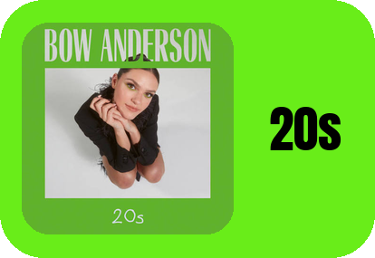
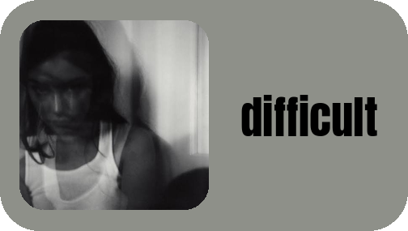
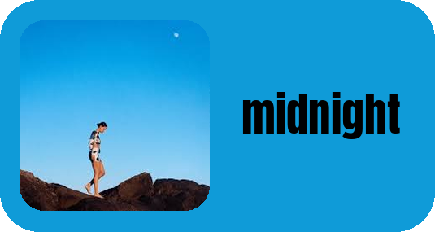
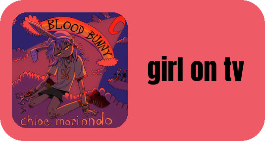
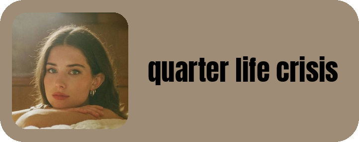

# Aziz / azizhehe01

Backend developer yang suka bongkar cara kerja sistem, Linux, dan AI.

<a href="https://github.com/azizhehe01">
  _Hello,+I'm+Aziz;>_Backend+Developer;>_Linux+Enthusiast;>_AI+Explorer" alt="Typing SVG" />
</a>

Sehari-hari gue ngulik backend di Erdigma. Di luar itu, lagi belajar arsitektur sistem dan eksperimen aplikasi berbasis AI. Kalau mau ngobrol soal salah satunya, kontak gue ada di bawah.

### Aktivitas ngoding

Streak = hari kontribusi GitHub berturut-turut, bukan ukuran kualitas kerja. Commit di repo privat hanya ikut terhitung kalau kontribusi privat ditampilkan di profil GitHub. Untuk gambaran progres, lihat juga proyek dan perubahan yang benar-benar dikirim.

### Yang biasa gue pakai

**Backend:**  

**Database:**  

**DevOps:**  

**AI / Tech Baru:**  

### Kontak

Mau diskusi backend, Linux, atau AI? Hubungi gue lewat salah satu kanal ini:

### Yang lagi gue putar: *Quarter Life Crisis*
> *ini rekomen lagu buat lo yang lagi di fase 20an buat nememin kegokilan hidup lo* ☕

  
  &nbsp;
  
  &nbsp;
  
  &nbsp;
  
    
  
  &nbsp;
  
  &nbsp;
  
    
  <i>(Klik banner buat langsung play lagunya di Spotify)</i> 🎵

*(Bakal terus gua update kalau nemu lagu yang pas sama mood-nya)* ✨

---
*"Code works, but making it clean and scalable is an art."* ✨